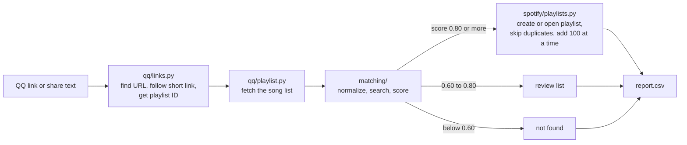

# QQ Music to Spotify Playlist Transfer: Build Plan

> **Status: in progress.** M1 to M4 are done: `qq2spotify inspect <link>` lists a QQ Music playlist's songs, `qq2spotify login` saves a Spotify login, and `qq2spotify match <link>` finds each song on Spotify and saves a report (108 of 109 found on a real playlist). Next is M5, creating the Spotify playlist. This README is the build plan; it will turn into the user guide as the code lands. Last updated 6 November 2026.

## Goal and how the tool works

You will build `qq2spotify`, a small open-source Python command-line tool. Give it a QQ Music playlist share link, and it adds every song it can find on Spotify to a playlist in the Spotify account that signs in. It reads only song information (title, singers, album, length) and never touches audio files.

What it does:

- Accepts a QQ Music playlist share link (web, mobile or short link) and works out the playlist ID.
- Reads the full song list from QQ Music's web service.
- Searches Spotify for each song, scores the results and keeps only confident matches.
- Creates a new playlist, or fills an existing one, in the target Spotify account, keeping the original order.
- Writes a report of songs it could not match, so you can add them by hand.

What it does not do:

- It cannot write to a Spotify account unless that account's owner signs in once through Spotify's own login page.
- It cannot copy songs that Spotify does not have. Chinese catalogues differ by region and licence, so expect some gaps.
- It never asks for a QQ Music password. It reads playlists that anyone with the link can open; private playlists may fail.

## Read this first: rules that shape the design

Spotify's 2026 developer rules decide most of the design: your app stays in Development Mode, its owner needs Premium, and at most 5 accounts can use it. QQ Music has no official public API, so the QQ side relies on unofficial web endpoints that can change.

**Spotify rules (checked 5 Nov 2026)**

| Rule | What it means for qq2spotify |
| --- | --- |
| Development Mode apps need the app owner to have Premium; the app stops if it lapses ([quota modes](https://developer.spotify.com/documentation/web-api/concepts/quota-modes)) | Create the app with your Premium account |
| Up to 5 users per app, each added by name and Spotify email under Settings → User Management; unlisted users get 403 ([quota modes](https://developer.spotify.com/documentation/web-api/concepts/quota-modes)) | Add the target account before it signs in |
| Extended quota is only for organizations with 250k+ monthly users ([quota modes](https://developer.spotify.com/documentation/web-api/concepts/quota-modes)) | Everyone who uses your GitHub project creates their own Spotify app |
| Search returns at most 10 results per request; the default is 5 ([search](https://developer.spotify.com/documentation/web-api/reference/search)) | Always send `limit=10` and run a few queries per song |
| Create playlists with `POST /me/playlists`; add songs with `POST /playlists/{id}/items`, max 100 per request ([migration guide](https://developer.spotify.com/documentation/web-api/tutorials/february-2026-migration-guide), [add items](https://developer.spotify.com/documentation/web-api/reference/add-items-to-playlist)) | `POST /users/{id}/playlists` and the `/tracks` playlist endpoints were removed in February 2026 |
| Playlist contents come back only for playlists the user owns or collaborates on ([migration guide](https://developer.spotify.com/documentation/web-api/tutorials/february-2026-migration-guide)) | You can still read the target playlist to skip duplicates |
| Track `popularity`, `available_markets` and `linked_from` were removed ([migration guide](https://developer.spotify.com/documentation/web-api/tutorials/february-2026-migration-guide)) | Don't use popularity in match scoring |
| Redirect URIs must use a loopback IP such as `http://127.0.0.1:8888/callback`; `localhost` is refused ([redirect URIs](https://developer.spotify.com/documentation/web-api/concepts/redirect_uri)) | Register that exact URI in the dashboard |
| Refresh tokens expire 6 months after sign-in, and refreshing doesn't extend them ([announcement](https://developer.spotify.com/blog/2026-06-18-refresh-token-expiration)) | Catch `invalid_grant` and ask the user to log in again |
| Calls are counted in a rolling 30-second window and a 429 carries `Retry-After` ([rate limits](https://developer.spotify.com/documentation/web-api/concepts/rate-limits)); Development Mode quota is shared per developer account, and a 429 with `QUOTA_EXCEEDED` means it is used up ([July 2026 changelog](https://developer.spotify.com/documentation/web-api/references/changes/july-2026)) | Wait out `Retry-After`; on `QUOTA_EXCEEDED`, save progress and stop |

**QQ Music**

- QQ Music offers no official public API for this. The tool reads the same web endpoint that open-source projects such as [uta](https://docs.rs/crate/uta/0.1.2/source/src/qq/playlist.rs), [Meting-API](https://huggingface.co/spaces/ZSCGR/Meting-API/blob/main/src/providers/tencent/playlist.js) and a copy of [Listen 1](https://huggingface.co/spaces/CatPtain/ListenOne/blob/main/js/provider/qq.js) use. Keep that code in one module, with saved responses as test fixtures, so a change on Tencent's side is quick to fix.
- Some user playlists return an empty song list unless you are signed in ([Apify scraper notes](https://apify.com/crawlerbros/qq-music-scraper.md)). Support an optional QQ cookie for those.
- QQ's newer `musicu.fcg` endpoint rejects data-centre IP addresses with code 500003 ([Apify scraper notes](https://apify.com/crawlerbros/qq-music-scraper.md)), so don't depend on it, least of all in CI.

**Legal basics (not legal advice)**

- Read only song information; never download audio.
- Say in the README that the project isn't affiliated with Tencent or Spotify, and follow the [Spotify Developer Terms](https://developer.spotify.com/terms) and [Developer Policy](https://developer.spotify.com/policy).
- Treat QQ cookies and Spotify tokens like passwords.

## Tech stack and project layout

Build it in Python 3.11+ as a command-line tool, with your own small HTTP client for both services instead of a Spotify library.

| Need | Library | Why this one |
| --- | --- | --- |
| HTTP | `httpx` | Timeouts, redirects and connection reuse built in; easy to fake in tests with `respx` |
| Command line | `typer` | Commands and `--help` straight from type hints |
| Progress and tables | `rich` | Progress bar and a readable summary |
| Fuzzy matching | `rapidfuzz` | Fast string similarity scores |
| Traditional ↔ Simplified Chinese | `opencc-python-reimplemented` | Pure Python, nothing to compile |
| Config and cache folders | `platformdirs` | The right folder on Windows, macOS and Linux |
| `.env` loading | `python-dotenv` | Reads `SPOTIFY_CLIENT_ID` |
| Tests | `pytest`, `respx` | Fake HTTP responses, no real API calls |
| Lint and format | `ruff` | One fast tool for both |

Why not spotipy: [spotipy 2.26.0](https://newreleases.io/project/github/spotipy-dev/spotipy/release/2.26.0) moved to the new `/items` endpoints, but the February 2026 changes removed several endpoints and libraries tend to trail them. You need only about six Spotify calls, so owning them keeps errors easy to read.

**How the parts connect**



**Folder layout**

```text
qq2spotify/
├── README.md
├── LICENSE
├── pyproject.toml
├── .env.example
├── .gitignore
├── .github/workflows/ci.yml
├── src/qq2spotify/
│   ├── __init__.py
│   ├── __main__.py          # python -m qq2spotify
│   ├── cli.py               # commands: login, inspect, transfer
│   ├── models.py            # SourceTrack, Candidate, MatchResult
│   ├── config.py            # env vars and folders
│   ├── http.py              # shared httpx client and retries
│   ├── qq/
│   │   ├── links.py         # share link -> playlist ID
│   │   └── playlist.py      # playlist ID -> list of SourceTrack
│   ├── spotify/
│   │   ├── auth.py          # PKCE login, token cache, refresh
│   │   ├── client.py        # the HTTP calls
│   │   └── playlists.py     # create, read, add in batches
│   ├── matching/
│   │   ├── normalize.py     # text cleaning, OpenCC
│   │   ├── search.py        # query cascade
│   │   ├── score.py         # scoring rules
│   │   └── aliases.json     # Chinese -> Spotify artist names
│   ├── cache.py             # SQLite cache of matches
│   └── report.py            # CSV report and summary
└── tests/
    ├── fixtures/            # saved QQ and Spotify responses
    ├── test_links.py
    ├── test_qq_playlist.py
    ├── test_normalize.py
    ├── test_score.py
    ├── test_spotify_client.py
    └── test_cli.py
```

**Data models** (`models.py`)

```python
from dataclasses import dataclass
from typing import Literal

@dataclass(frozen=True)
class SourceTrack:
    position: int                 # order in the QQ playlist, from 0
    title: str
    artists: tuple[str, ...]
    album: str | None
    duration_ms: int | None
    qq_mid: str                   # QQ song ID (songmid)

@dataclass(frozen=True)
class Candidate:
    uri: str                      # spotify:track:...
    title: str
    artists: tuple[str, ...]
    album: str
    duration_ms: int

@dataclass
class MatchResult:
    source: SourceTrack
    status: Literal["matched", "review", "not_found"]
    best: Candidate | None = None
    score: float = 0.0
    query: str | None = None      # the search that found it
```

## Phase 1: Setup

Create one Spotify app on your Premium account, register the loopback redirect URI, and allowlist the target account before you write any code.

**Spotify developer app**

1. Make sure the account that will own the app has Premium. Your own account works.
2. Open the [Spotify Developer Dashboard](https://developer.spotify.com/dashboard) and choose Create app.
3. Fill in a name (`qq2spotify-dev`), any description, the redirect URI `http://127.0.0.1:8888/callback`, and tick Web API.
4. Copy the Client ID. With PKCE login you never need the client secret, so keep it out of the project.
5. Open Settings → User Management → Add new user. Add every account that will sign in: the target account (its name and Spotify email), and yourself if you test with your own account. Five accounts at most.

**Local environment**

1. Install Python 3.11 or newer, and Git.
2. Clone your empty repo and create a virtual environment:

```bash
git clone https://github.com/<your-user>/qq2spotify.git
cd qq2spotify
python -m venv .venv
source .venv/bin/activate        # Windows: .venv\Scripts\activate
pip install -e ".[dev]"
```

3. Create `.env.example` (committed) and copy it to `.env` (never committed):

```dotenv
SPOTIFY_CLIENT_ID=paste-your-client-id
SPOTIFY_REDIRECT_URI=http://127.0.0.1:8888/callback
```

4. Start `pyproject.toml` with the dependencies and a `qq2spotify` command:

```toml
[project]
name = "qq2spotify"
version = "0.1.0"
requires-python = ">=3.11"
dependencies = [
  "httpx>=0.27",
  "typer>=0.12",
  "rich>=13",
  "rapidfuzz>=3",
  "opencc-python-reimplemented>=0.1.7",
  "platformdirs>=4",
  "python-dotenv>=1",
]

[project.optional-dependencies]
dev = ["pytest>=8", "respx>=0.21", "ruff>=0.6"]

[project.scripts]
qq2spotify = "qq2spotify.cli:app"

[build-system]
requires = ["hatchling"]
build-backend = "hatchling.build"

[tool.hatch.build.targets.wheel]
packages = ["src/qq2spotify"]
```

## Phase 2: Read the QQ Music share link

Accept whatever the user pastes, pull out the first URL, follow short links, and end with the numeric playlist ID that QQ calls `disstid`.

| Link type | Example (made-up ID) | How to get the ID |
| --- | --- | --- |
| Desktop web | `https://y.qq.com/n/ryqq/playlist/7891234567` | Digits after `/playlist/` |
| Older desktop web | `https://y.qq.com/n/yqq/playlist/7891234567.html` | Digits before `.html` |
| Mobile share page | `https://i.y.qq.com/n2/m/share/details/taoge.html?id=7891234567&...` | The `id` query value |
| Short link from the app | `https://c6.y.qq.com/base/fcgi-bin/u?__=AbC123` | Follow the redirects, then read the final URL |
| Share text from WeChat or QQ | `分享歌单《夜跑》https://c6.y.qq.com/base/fcgi-bin/u?__=AbC123 @QQ音乐` | Find the URL first |
| Bare ID | `7891234567` | Use it as is |

The desktop format is the one [uta](https://docs.rs/crate/uta/0.1.2/source/src/qq/playlist.rs) and [Listen 1](https://huggingface.co/spaces/CatPtain/ListenOne/blob/main/js/provider/qq.js) build links with, and [this QQ parser](https://huggingface.co/spaces/Genius-Society/qmusic_parser/blob/main/app.py) resolves `c6.y.qq.com` short links by following redirects. Confirm the mobile formats first: collect 3 to 5 real links from the Android, iPhone and desktop apps and save them as test cases, because the app changes its formats over time.

**Steps**

1. Trim the input. If it is only digits, it is already the ID.
2. Find the first `http(s)://` URL with a regex, and drop trailing Chinese punctuation such as `》` or `，`.
3. If the host is `c.y.qq.com` or `c6.y.qq.com` and the path has `/base/fcgi-bin/u`, request it with redirects on and a browser User-Agent, then use the final URL.
4. Read `id`, `disstid` or `dissid` from the query string; otherwise match `/playlist/(\d+)` in the path.
5. Reject song and album links (`songDetail`, `albumDetail`, `songmid=`) with a clear message.

**Code sketch** (`qq/links.py`)

```python
import re
from urllib.parse import parse_qs, urlparse

import httpx

URL_RE = re.compile(r"https?://[^\s\u3000，。》」)]+")
SHORT_HOSTS = {"c.y.qq.com", "c6.y.qq.com"}
UA = ("Mozilla/5.0 (Windows NT 10.0; Win64; x64) AppleWebKit/537.36 "
      "(KHTML, like Gecko) Chrome/130.0 Safari/537.36")

class LinkError(ValueError):
    pass

def _is_id(value: str) -> bool:
    return value.isascii() and value.isdigit()

def extract_playlist_id(text: str, client: httpx.Client) -> str:
    text = text.strip()
    if _is_id(text):
        return text
    match = URL_RE.search(text)
    if not match:
        raise LinkError("No link found. Paste a QQ Music playlist link.")
    url = match.group(0)
    if urlparse(url).hostname in SHORT_HOSTS and "/base/fcgi-bin/u" in url:
        response = client.get(url, follow_redirects=True, timeout=10,
                              headers={"User-Agent": UA})
        url = str(response.url)
    if any(key in url for key in ("songDetail", "albumDetail", "songmid=")):
        raise LinkError("This is a song or album link, not a playlist link.")
    parsed = urlparse(url)
    query = parse_qs(parsed.query)
    for key in ("id", "disstid", "dissid"):
        value = query.get(key, [""])[0]
        if _is_id(value):
            return value
    found = re.search(r"/playlist/(\d+)", parsed.path)
    if found:
        return found.group(1)
    raise LinkError(f"Couldn't find a playlist ID in {url}")
```

## Phase 3: Fetch the songs from QQ Music

One GET request to QQ's `fcg_ucc_getcdinfo_byids_cp.fcg` endpoint returns the playlist name and its whole song list as JSON.

**Request:** `GET https://c.y.qq.com/qzone/fcg-bin/fcg_ucc_getcdinfo_byids_cp.fcg`

| Parameter | Value |
| --- | --- |
| `disstid` | The playlist ID |
| `type` | `1` |
| `json` | `1` |
| `utf8` | `1` |
| `onlysong` | `0` |
| `format` | `json` |
| `loginUin` | `0` |

Send `Referer: https://y.qq.com/n/ryqq/playlist/<id>` and a normal browser `User-Agent`. These match [uta](https://docs.rs/crate/uta/0.1.2/source/src/qq/playlist.rs) and [Meting-API](https://huggingface.co/spaces/ZSCGR/Meting-API/blob/main/src/providers/tencent/playlist.js). As a fallback host, [Listen 1](https://huggingface.co/spaces/CatPtain/ListenOne/blob/main/js/provider/qq.js) calls `https://i.y.qq.com/qzone-music/fcg-bin/fcg_ucc_getcdinfo_byids_cp.fcg` with `nosign=1`.

**Response fields**

| JSON path | Meaning | Goes into |
| --- | --- | --- |
| `code` | `0` means success | Error check |
| `cdlist[0].dissname` | Playlist name | Default Spotify playlist name |
| `cdlist[0].songlist[]` (uta also checks `list`) | The songs, in order | One `SourceTrack` each |
| `songmid` | QQ song ID | `qq_mid` |
| `songname` | Title; may contain HTML entities | `title` |
| `singer[].name` | Singers | `artists` |
| `albumname` | Album name | `album` |
| `interval` | Length in seconds | `duration_ms = interval * 1000` |

**Handling the response**

- uta's author notes that the whole playlist comes back in one response, with no pages. Still compare the count with what the app shows, and warn if they differ.
- Run `html.unescape` on text fields, as Listen 1 does.
- Skip entries with no `songmid`, and drop repeated `songmid`s while keeping the first position.
- If the body starts with a callback name instead of `{`, cut from the first `{` to the last `}` before parsing.
- A `code` other than 0, or an empty list, usually means a private or login-only playlist: say so and suggest `--qq-cookie`.
- Add `--save-raw` to write the raw JSON for bug reports.

First milestone: `qq2spotify inspect <link>` prints the songs as a table. Build and test this before touching Spotify.

**Code sketch** (`qq/playlist.py`)

```python
import html
import json

import httpx

from qq2spotify.models import SourceTrack
from qq2spotify.qq.links import UA

ENDPOINT = "https://c.y.qq.com/qzone/fcg-bin/fcg_ucc_getcdinfo_byids_cp.fcg"

class QQError(RuntimeError):
    pass

def fetch_playlist(playlist_id: str, client: httpx.Client,
                   cookie: str | None = None) -> tuple[str, list[SourceTrack]]:
    params = {"disstid": playlist_id, "type": 1, "json": 1, "utf8": 1,
              "onlysong": 0, "format": "json", "loginUin": 0}
    headers = {"Referer": f"https://y.qq.com/n/ryqq/playlist/{playlist_id}",
               "User-Agent": UA}
    if cookie:
        headers["Cookie"] = cookie
    response = client.get(ENDPOINT, params=params, headers=headers, timeout=15)
    response.raise_for_status()

    body = response.text
    start, end = body.find("{"), body.rfind("}")
    if start == -1 or end == -1:
        raise QQError("QQ Music did not return JSON.")
    data = json.loads(body[start:end + 1])
    if data.get("code") != 0 or not data.get("cdlist"):
        raise QQError(f"QQ Music returned code {data.get('code')}. "
                      "The playlist may be private; try --qq-cookie.")

    cd = data["cdlist"][0]
    seen: set[str] = set()
    tracks: list[SourceTrack] = []
    for song in cd.get("songlist") or cd.get("list") or []:
        mid = song.get("songmid")
        if not mid or mid in seen:
            continue
        seen.add(mid)
        interval = song.get("interval")
        tracks.append(SourceTrack(
            position=len(tracks),
            title=html.unescape(song.get("songname", "")).strip(),
            artists=tuple(html.unescape(s["name"]).strip()
                          for s in song.get("singer", []) if s.get("name")),
            album=html.unescape(song.get("albumname", "")).strip() or None,
            duration_ms=int(interval) * 1000 if interval else None,
            qq_mid=mid,
        ))
    if not tracks:
        raise QQError("The playlist came back empty. It may be login-only; "
                      "try --qq-cookie.")
    name = html.unescape(cd.get("dissname") or f"QQ playlist {playlist_id}")
    return name, tracks
```

## Phase 4: Log in to the target Spotify account

Use the Authorization Code flow with PKCE: the target account signs in once in a browser, and the tool keeps a refresh token for it that lasts up to 6 months.

**Scopes:** `playlist-modify-public` and `playlist-modify-private` to create playlists and add songs ([create playlist](https://developer.spotify.com/documentation/web-api/reference/create-playlist)), plus `playlist-read-private` to read a private target playlist when skipping duplicates.

**Login flow** ([PKCE tutorial](https://developer.spotify.com/documentation/web-api/tutorials/code-pkce-flow))

1. Make a `code_verifier`: 64 random characters from letters, digits and `_ . - ~` (43 to 128 are allowed).
2. Make the `code_challenge`: SHA-256 of the verifier, base64url-encoded, with the `=` padding removed.
3. Make a random `state` value.
4. Open `https://accounts.spotify.com/authorize` with `client_id`, `response_type=code`, `redirect_uri`, `scope`, `code_challenge_method=S256`, `code_challenge`, `state` and `show_dialog=true`. That last one makes Spotify show the consent page even if this browser approved the app before ([code flow](https://developer.spotify.com/documentation/web-api/tutorials/code-flow)), which gives you a chance to switch accounts.
5. Listen once on `127.0.0.1:8888` for `/callback?code=...&state=...`, and check that `state` matches.
6. POST to `https://accounts.spotify.com/api/token` as a form: `grant_type=authorization_code`, `code`, `redirect_uri`, `client_id`, `code_verifier`.
7. Call `GET /me`, print `Signed in as <name> (<id>)`, and save the tokens under the account's nickname.

**Token file**, one per account, at `<config folder>/tokens/<account>.json` with permission 600:

```json
{
  "access_token": "...",
  "refresh_token": "...",
  "expires_at": 1793000000,
  "scope": "playlist-modify-private playlist-modify-public playlist-read-private",
  "authorized_at": "2026-11-05T20:15:00Z",
  "spotify_user_id": "abc123",
  "display_name": "Friend"
}
```

**Refreshing** ([refreshing tokens](https://developer.spotify.com/documentation/web-api/tutorials/refreshing-tokens))

- Refresh when `expires_at` is less than 60 seconds away: POST the token endpoint with `grant_type=refresh_token`, `refresh_token` and `client_id`. PKCE needs no Authorization header.
- If the response has a new `refresh_token`, save it; if not, keep the old one.
- On a 401 from the API, refresh once and retry the call.
- On `400 invalid_grant`, delete the token file and ask the user to run `qq2spotify login --account <name>` again. Spotify doesn't say when a token was issued, so keep `authorized_at` yourself and warn when 6 months is near.

**Signing in the other account**

1. Add it under User Management first (Phase 1).
2. Run `qq2spotify login --account friend`.
3. On Spotify's page, switch away from your own account, or open the printed link in a private window and sign in as the target account.
4. The redirect goes to `127.0.0.1` on the computer running the tool, so sign in on that computer. If the owner is elsewhere, add a fallback: they open the printed link on their device, the final page fails to load, and they send you the URL it ended on. Paste it into the waiting tool within a few minutes; it holds the `code` and `state`.
5. Check the printed name before transferring anything.

**Option B, test before relying on it:** the other account makes a collaborative playlist and invites you, then you sign in with your own account and use `--to-playlist`. Spotify still returns contents for playlists you collaborate on ([migration guide](https://developer.spotify.com/documentation/web-api/tutorials/february-2026-migration-guide)); confirm that adding songs works too before you build on it.

**Code sketch** (`spotify/auth.py`, login part)

```python
import base64
import hashlib
import secrets
import string
import webbrowser
from http.server import BaseHTTPRequestHandler, HTTPServer
from urllib.parse import parse_qs, urlencode, urlparse

import httpx

AUTH_URL = "https://accounts.spotify.com/authorize"
TOKEN_URL = "https://accounts.spotify.com/api/token"
SCOPES = "playlist-modify-public playlist-modify-private playlist-read-private"
ALPHABET = string.ascii_letters + string.digits + "_.-~"

def make_pkce_pair() -> tuple[str, str]:
    verifier = "".join(secrets.choice(ALPHABET) for _ in range(64))
    digest = hashlib.sha256(verifier.encode()).digest()
    challenge = base64.urlsafe_b64encode(digest).rstrip(b"=").decode()
    return verifier, challenge

def wait_for_callback(port: int) -> dict[str, str]:
    result: dict[str, str] = {}

    class Handler(BaseHTTPRequestHandler):
        def do_GET(self):
            query = parse_qs(urlparse(self.path).query)
            result.update({key: values[0] for key, values in query.items()})
            self.send_response(200)
            self.send_header("Content-Type", "text/plain; charset=utf-8")
            self.end_headers()
            self.wfile.write("Done. You can close this tab.".encode())

        def log_message(self, *args):
            pass

    with HTTPServer(("127.0.0.1", port), Handler) as server:
        while "code" not in result and "error" not in result:
            server.handle_request()
    return result

def login(client_id: str, redirect_uri: str, http: httpx.Client) -> dict:
    verifier, challenge = make_pkce_pair()
    state = secrets.token_urlsafe(16)
    url = AUTH_URL + "?" + urlencode({
        "client_id": client_id, "response_type": "code",
        "redirect_uri": redirect_uri, "scope": SCOPES,
        "code_challenge_method": "S256", "code_challenge": challenge,
        "state": state, "show_dialog": "true",
    })
    print(f"If no browser opens, visit:\n{url}")
    webbrowser.open(url)
    params = wait_for_callback(urlparse(redirect_uri).port or 8888)
    if params.get("state") != state or "code" not in params:
        raise RuntimeError(f"Login failed: {params.get('error', 'state mismatch')}")
    response = http.post(TOKEN_URL, data={
        "grant_type": "authorization_code", "code": params["code"],
        "redirect_uri": redirect_uri, "client_id": client_id,
        "code_verifier": verifier,
    })
    response.raise_for_status()
    return response.json()  # access_token, refresh_token, expires_in, scope
```

## Phase 5: Find each song on Spotify

Matching is the hard part: run a short cascade of searches per song, score every result from 0 to 1, and add only songs that score 0.80 or more.

**1. Clean the text on both sides** (`matching/normalize.py`)

1. `html.unescape`, then Unicode NFKC so full-width letters and digits become normal ones.
2. Lower-case and trim.
3. Convert Traditional to Simplified Chinese with OpenCC (`t2s`) before comparing, because Spotify often lists Taiwan and Hong Kong releases in Traditional characters.
4. Move bracketed extras — `()`, `（）`, `[]`, `【】` — and Spotify's dash suffixes (`Song - Live`) out of the core title.
5. Sort those extras: `feat.`, `ft.` and `with` name extra artists; live, remix, demo, instrumental or 伴奏, karaoke or KTV, cover or 翻唱, DJ版, 女版 or 男版, sped up or 加速版, and slowed or 慢速版 are version tags; anything else (a TV show credit, "Remastered 2011") is ignored.
6. Drop punctuation and spaces, for comparison only.

| QQ title (illustrative) | Core title | Version tags |
| --- | --- | --- |
| `晴天 (Live)` | `晴天` | live |
| `说好不哭（with 五月天阿信）` | `说好不哭` | none; 阿信 is an extra artist |
| `Mojito (伴奏)` | `mojito` | instrumental |
| `孤勇者 (《英雄联盟：双城之战》动画剧集中文主题曲)` | `孤勇者` | none; the credit is ignored |

**2. Search cascade** (`matching/search.py`)

Each step is `GET /search?type=track&limit=10&q=...`. Stop at the first step whose best result scores 0.80 or more, and never send more than 6 searches for one song.

| Step | Query (`q`) | What it catches |
| --- | --- | --- |
| 1 | `track:<core title> artist:<first singer>` | Exact listings |
| 2 | `<core title> <first singer>`, no filters | Small spelling differences |
| 3 | Step 1 with Traditional Chinese (OpenCC `s2tw`, then `s2hk`) | Taiwan and Hong Kong releases |
| 4 | Step 1 with the singer's name from `aliases.json` | Artists listed under English names |
| 5 | `track:<core title>` only | Unknown artist spellings; length and album decide |

The `track:`, `artist:` and `album:` filters come from the [search reference](https://developer.spotify.com/documentation/web-api/reference/search). With a user token, results follow that user's country, so songs not licensed there can't be found at all.

**Artist aliases:** Spotify often lists Chinese artists under English names, for example 周杰伦 as Jay Chou, 林俊杰 as JJ Lin, 陈奕迅 as Eason Chan and 邓紫棋 as G.E.M. Ship a small `aliases.json` that users can extend. When the title and length match closely but the artist name doesn't, log the pair as a suggested alias.

**3. Score each candidate** (`matching/score.py`)

Score = 0.45 × title + 0.35 × artist + 0.15 × length + 0.05 × album, minus penalties, kept between 0 and 1.

| Part | How to compute it (0 to 1) |
| --- | --- |
| Title | `rapidfuzz.fuzz.ratio` of the cleaned core titles ÷ 100 |
| Artist | Best `fuzz.token_set_ratio` between any QQ singer (plus aliases) and any Spotify artist ÷ 100 |
| Length | 1.0 within 3 seconds, falling in a straight line to 0 at 15 seconds; 0.5 if either is missing |
| Album | `fuzz.ratio` of the cleaned album names ÷ 100; 0.5 if missing |
| Penalty | −0.30 if Spotify's title has a version tag the QQ title lacks; −0.15 for the reverse |

| Score | Result | What happens |
| --- | --- | --- |
| 0.80 or more | matched | Added to the playlist |
| 0.60 to 0.80 | review | Listed in the report; added only with `--include-review` |
| Below 0.60 | not found | Listed in the report |

**Tuning:** hand-label 50 songs from your own playlists (the QQ song plus the right Spotify URI, or "not on Spotify") in `tests/fixtures/labelled_matches.json`. Adjust the weights until at least 98% of "matched" songs are right; a wrong song in a playlist annoys people more than a missing one.

**Cache:** store each result in SQLite, keyed by cleaned title, singers and length rounded to 5 seconds, so reruns and other playlists skip the search.

**Code sketch** (`matching/score.py`)

```python
from rapidfuzz import fuzz

from qq2spotify.matching.normalize import clean, core_title, version_tags
from qq2spotify.models import Candidate, SourceTrack

def length_score(a_ms: int | None, b_ms: int | None) -> float:
    if not a_ms or not b_ms:
        return 0.5
    diff = abs(a_ms - b_ms) / 1000
    if diff <= 3:
        return 1.0
    return max(0.0, 1 - (diff - 3) / 12)

def score(src: SourceTrack, cand: Candidate,
          aliases: dict[str, list[str]]) -> float:
    title = fuzz.ratio(core_title(src.title), core_title(cand.title)) / 100
    names = {clean(a) for a in src.artists}
    for singer in src.artists:
        names.update(clean(alias) for alias in aliases.get(singer, []))
    artist = max((fuzz.token_set_ratio(q, clean(s)) / 100
                  for q in names for s in cand.artists), default=0.0)
    album = (fuzz.ratio(clean(src.album), clean(cand.album)) / 100
             if src.album else 0.5)
    total = (0.45 * title + 0.35 * artist
             + 0.15 * length_score(src.duration_ms, cand.duration_ms)
             + 0.05 * album)
    if version_tags(cand.title) - version_tags(src.title):
        total -= 0.30
    if version_tags(src.title) - version_tags(cand.title):
        total -= 0.15
    return max(0.0, min(1.0, total))
```

## Phase 6: Create the playlist and add the songs

Create a private playlist (or open an existing one), skip songs already in it, then add the matches in QQ order, 100 per request, one request at a time.

**Steps**

1. Pick the target.
   - New playlist (the default): `POST /me/playlists` with `{"name": "<QQ name> (from QQ Music)", "public": false, "description": "Imported from QQ Music playlist <id> with qq2spotify"}`. A 201 response returns the new `id` ([create playlist](https://developer.spotify.com/documentation/web-api/reference/create-playlist)).
   - Existing playlist: `--to-playlist <Spotify link or ID>`. It must belong to, or be collaborative with, the signed-in account.
2. Read what is already there with `GET /playlists/{id}/items`, page by page, until `next` is empty. Each entry's track now sits under `item`; it was `track` before February 2026 ([migration guide](https://developer.spotify.com/documentation/web-api/tutorials/february-2026-migration-guide)).
3. Remove duplicates: songs already in the playlist, and songs matched twice in this run (two QQ versions can map to one Spotify track).
4. Split the remaining URIs into chunks of 100 and send `POST /playlists/{id}/items` with `{"uris": [...]}` for each chunk, one after another ([add items](https://developer.spotify.com/documentation/web-api/reference/add-items-to-playlist)). Sending chunks in parallel would scramble the order.
5. After each chunk, save progress to a run file, so a crash or `QUOTA_EXCEEDED` resumes where it stopped.
6. Print the playlist link, `https://open.spotify.com/playlist/<id>`.

**Error handling for every Spotify call** (`spotify/client.py`)

| Response | What to do |
| --- | --- |
| 429 with `Retry-After` | Sleep that many seconds, then retry the same request |
| 429 with reason `QUOTA_EXCEEDED` | Save progress, stop, and tell the user to run again later |
| 401 | Refresh the token once, then retry |
| 403 | The account isn't on the app's allowlist, the owner's Premium lapsed, or the playlist isn't theirs |
| 500 to 599 | Retry a read up to 3 times, waiting 1, 2, then 4 seconds. Never resend a write: it may have gone through, so stop and ask for the command to be run again, which skips the songs already added |

**Code sketch** (`spotify/client.py` and `spotify/playlists.py`)

```python
import time
from collections.abc import Callable, Iterable

import httpx

API = "https://api.spotify.com/v1"

class QuotaExceeded(RuntimeError):
    pass

def _reason(response: httpx.Response) -> str | None:
    try:
        return response.json().get("error", {}).get("reason")
    except ValueError:
        return None

class SpotifyClient:
    def __init__(self, tokens, http: httpx.Client):
        self.tokens = tokens  # has .access_token() and .refresh()
        self.http = http

    def request(self, method: str, path: str, **kwargs) -> dict:
        url = path if path.startswith("http") else API + path  # "next" links are full URLs
        refreshed, server_errors = False, 0
        while True:
            headers = {"Authorization": f"Bearer {self.tokens.access_token()}"}
            response = self.http.request(method, url, headers=headers,
                                         timeout=20, **kwargs)
            if response.status_code == 401 and not refreshed:
                self.tokens.refresh()
                refreshed = True
                continue
            if response.status_code == 429:
                if _reason(response) == "QUOTA_EXCEEDED":
                    raise QuotaExceeded("Spotify quota used up. Run again later.")
                time.sleep(int(response.headers.get("Retry-After", "5")))
                continue
            # Only reads: a failed write may have gone through anyway.
            if response.status_code >= 500 and method == "GET" and server_errors < 3:
                time.sleep(2 ** server_errors)
                server_errors += 1
                continue
            response.raise_for_status()
            return response.json() if response.content else {}

    def get(self, path: str, **kwargs) -> dict:
        return self.request("GET", path, **kwargs)

    def post(self, path: str, **kwargs) -> dict:
        return self.request("POST", path, **kwargs)

def existing_uris(api: SpotifyClient, playlist_id: str) -> set[str]:
    uris: set[str] = set()
    url: str | None = f"/playlists/{playlist_id}/items"
    params: dict | None = {"limit": 50, "offset": 0}
    while url:
        page = api.get(url, params=params)
        for entry in page.get("items", []):
            uri = (entry.get("item") or {}).get("uri")
            if uri:
                uris.add(uri)
        url, params = page.get("next"), None
    return uris

def add_in_order(api: SpotifyClient, playlist_id: str, uris: Iterable[str],
                 on_chunk_done: Callable[[int], None]) -> int:
    pending = list(dict.fromkeys(uris))  # drop repeats, keep order
    for start in range(0, len(pending), 100):
        chunk = pending[start:start + 100]
        api.post(f"/playlists/{playlist_id}/items", json={"uris": chunk})
        on_chunk_done(start + len(chunk))
    return len(pending)
```

## Phase 7: Command line, dry run, reports and resume

Three commands — `login`, `inspect` and `transfer` — plus a dry run and a CSV report make the tool safe to try on a big playlist.

**Commands** (`cli.py`, built with typer)

```bash
qq2spotify login --account friend          # sign in once per account
qq2spotify accounts                        # list saved sign-ins
qq2spotify inspect "<QQ link or share text>"
qq2spotify transfer "<QQ link>" --account friend --dry-run
qq2spotify transfer "<QQ link>" --account friend --playlist-name "Night run"
qq2spotify transfer "<QQ link>" --account friend \
    --to-playlist https://open.spotify.com/playlist/<id>
qq2spotify logout --account friend
```

**Options for `transfer`**

| Option | Default | Meaning |
| --- | --- | --- |
| `--account` | `default` | Which saved sign-in to use |
| `--playlist-name` | QQ name + " (from QQ Music)" | Name for a new playlist |
| `--to-playlist` | none | Add to this existing playlist instead |
| `--public` / `--private` | private | Visibility of a new playlist |
| `--dry-run` | off | Search, write the report and show what would be added, but create and add nothing |
| `--min-score` | 0.80 | Lowest score that counts as matched |
| `--include-review` | off | Also add songs scoring 0.60 to 0.80 |
| `--report` | `report-<QQ id>.csv` | Where to write the report |
| `--qq-cookie` | none | File holding your y.qq.com cookie, for login-only playlists |
| `--no-cache` | off | Search again even when a cached match exists |
| `--verbose` | off | Show every query and the top 3 candidates with scores |

**Report:** one row per QQ song with `position, qq_title, qq_artists, qq_album, qq_length, status, score, spotify_title, spotify_artists, spotify_album, spotify_url, query`. Write it as UTF-8 with a byte-order mark (`encoding="utf-8-sig"`) so Excel shows Chinese correctly.

**Summary at the end** (numbers illustrative)

```text
QQ playlist: 夜跑 (212 songs)
Matched 183 · Review 11 · Not found 18
Added 183 to "夜跑 (from QQ Music)"  https://open.spotify.com/playlist/<id>
Report: report-7891234567.csv
```

**Exit codes:** 0 when every song matched; 1 on an error; 2 when it finished but some songs need review or weren't found; 3 when the Spotify quota stopped it (run the same command again to resume).

**Files the tool keeps** (folders from `platformdirs`)

| File | Holds |
| --- | --- |
| `<config>/tokens/<account>.json` | Spotify tokens for one account |
| `<cache>/matches.sqlite` | Search results and scores |
| `<cache>/runs/<QQ id>-<Spotify playlist id>.json` | How many songs were added, for resuming |

**Resume:** when a run file exists for the same QQ playlist and target, continue from it. Together with the duplicate check in Phase 6, running the same command twice never adds a song twice.

**Logging:** `--verbose` prints each query and its top candidates, which you need for tuning. Never log tokens or cookies.

## Testing

Unit tests run offline against saved responses, and one manual run with a 10-song playlist proves the whole chain.

| Area | What to test | How |
| --- | --- | --- |
| `qq/links.py` | Every link format, share text with Chinese punctuation, bare IDs, song and album links rejected | `pytest.mark.parametrize`; the short-link redirect faked with `respx` |
| `qq/playlist.py` | A saved response; `code` not 0; an empty list; HTML entities; a callback wrapper; repeated `songmid` | Real responses trimmed to about 10 songs in `tests/fixtures/` |
| `matching/normalize.py` | Traditional vs Simplified, brackets, dash suffixes, `feat.`, full-width text | A table of inputs and expected outputs |
| `matching/score.py` | Live vs studio, karaoke penalty, length edges at 3 and 15 seconds, alias matches | The 50 hand-labelled songs: assert each one's band |
| `spotify/client.py` | 429 with `Retry-After` retried; `QUOTA_EXCEEDED` stops; 401 refreshes once; a write that hit a server error isn't resent; `invalid_grant` asks for a new login | `respx` routes, with `time.sleep` patched out |
| `spotify/playlists.py` | 250 URIs become 3 requests (100, 100, 50) in order; duplicates skipped | `respx` call history |
| `cli.py` | `--dry-run` writes a report and sends no POST; exit codes | typer's `CliRunner` plus `respx` |

**Example tests** (`tests/test_links.py`)

```python
import httpx
import pytest
import respx

from qq2spotify.qq.links import LinkError, extract_playlist_id

SHARE_TEXT = ("分享歌单《夜跑》https://i.y.qq.com/n2/m/share/details/taoge.html"
              "?id=7891234567&ADTAG=wxfshare @QQ音乐")

@pytest.mark.parametrize("text, expected", [
    ("7891234567", "7891234567"),
    ("https://y.qq.com/n/ryqq/playlist/7891234567", "7891234567"),
    ("https://y.qq.com/n/yqq/playlist/7891234567.html", "7891234567"),
    (SHARE_TEXT, "7891234567"),
])
def test_extracts_id(text, expected):
    with httpx.Client() as client:
        assert extract_playlist_id(text, client) == expected

@respx.mock
def test_follows_short_link():
    short = "https://c6.y.qq.com/base/fcgi-bin/u?__=AbC123"
    final = "https://i.y.qq.com/n2/m/share/details/taoge.html?id=7891234567"
    respx.get(short).mock(return_value=httpx.Response(302, headers={"Location": final}))
    respx.get(final).mock(return_value=httpx.Response(200, text="<html></html>"))
    with httpx.Client() as client:
        assert extract_playlist_id(short, client) == "7891234567"

def test_rejects_song_link():
    with httpx.Client() as client, pytest.raises(LinkError):
        extract_playlist_id("https://y.qq.com/n/ryqq/songDetail/001AbCdEfGhIjK", client)
```

**Manual end-to-end run**

- [ ] Make a public 10-song QQ playlist with a live version, a song with a Traditional Chinese title, an artist Spotify lists in English, and a song you expect Spotify not to have.
- [ ] `inspect` shows all 10 songs in order.
- [ ] `transfer --dry-run` writes a report; check every status by hand.
- [ ] `transfer` into a new private playlist; check the order in the Spotify app.
- [ ] Run the same command again: 0 songs added.
- [ ] Remove the app's access in the target account's Spotify settings, then run again: the tool asks you to log in.

CI never calls the real services. Put live tests behind `QQ2SPOTIFY_LIVE=1` and run them by hand.

## Publishing on GitHub

Publish an MIT-licensed repo with a clear README, a `.gitignore` that keeps tokens and cookies out, and a CI workflow that runs lint and tests on every push.

| File | Purpose |
| --- | --- |
| `README.md` | This plan for now; replace it with user docs as the code lands |
| `LICENSE` | MIT, the usual choice for small tools |
| `.gitignore` | Keeps secrets and local files out |
| `.env.example` | Lists the settings, with no real values |
| `CHANGELOG.md` | A line per change, grouped by release |
| `.github/workflows/ci.yml` | Lint and tests on every push and pull request |

**`.gitignore`**

```gitignore
.env
.venv/
__pycache__/
*.py[cod]
.pytest_cache/
.ruff_cache/
dist/
build/
*.egg-info/
*.sqlite
tokens/
report-*.csv
qq_cookie*.txt
```

**Secrets**

- With PKCE the Client ID isn't secret, but keep it in `.env` so every user brings their own app.
- Tokens and QQ cookies are secrets: never commit them and never print them.
- In the repo's Settings → Code security, turn on secret scanning and push protection.

**CI workflow** (`.github/workflows/ci.yml`)

```yaml
name: CI
on:
  push:
  pull_request:
jobs:
  test:
    runs-on: ubuntu-latest
    strategy:
      matrix:
        python-version: ["3.11", "3.12", "3.13"]
    steps:
      - uses: actions/checkout@v5
      - uses: actions/setup-python@v6
        with:
          python-version: ${{ matrix.python-version }}
      - run: pip install -e ".[dev]"
      - run: ruff check .
      - run: ruff format --check .
      - run: pytest -q
```

**README for the finished tool**

1. One-line description and a short GIF of `transfer` running.
2. Requirements: Python 3.11+, Spotify Premium for the app owner, and your own Spotify developer app (link to the Phase 1 steps).
3. Install: `pipx install git+https://github.com/<your-user>/qq2spotify`.
4. Quick start: `login`, `inspect`, a dry run, then `transfer`.
5. How matching works and how to read the report.
6. Limits: 5 accounts per Spotify app, songs missing in some countries, login-only QQ playlists, the unofficial QQ endpoint.
7. Troubleshooting (the table at the end of this plan).
8. Disclaimer: not affiliated with Tencent Music or Spotify; for personal use.
9. Contributing and license.

**Releasing**

1. Tag `v0.1.0` once the 10-song manual run passes.
2. Create a GitHub Release with notes from `CHANGELOG.md`.
3. Optionally publish to PyPI with Trusted Publishing from a GitHub Actions workflow, so users can run `pipx install qq2spotify`.
4. Add the topics `qq-music`, `spotify`, `playlist`, `python` and `cli` so people can find it.

## Milestones and checklist

Plan on about 8 working days for one developer (a rough estimate), in this order; each milestone ends with something you can run.

- [x] **M1 Setup (½ day):** Spotify app, allowlist, repo skeleton, `pyproject.toml`, `.gitignore`, and CI running one empty test.
- [x] **M2 `inspect` (1 day):** link parsing, QQ fetch, fixtures and tests; prints the songs of a real playlist.
- [x] **M3 `login` (1 day):** PKCE, token files, refresh and `GET /me`; both accounts signed in.
- [x] **M4 Matching (2 days):** cleaning, search cascade, scoring and aliases, tuned on a real 109-song playlist; the `qq2spotify match` command writes the report (108 matched, 1 rightly held back).
- [ ] **M5 `transfer` (1 day):** create or open the playlist, skip duplicates, add in chunks, retry on errors; the first real playlist copied.
- [ ] **M6 Polish (1 day):** progress bar, summary, cache, resume, exit codes and `--verbose`.
- [ ] **M7 Tests (1 day):** fill in the testing table above, then do the manual end-to-end run.
- [ ] **M8 Release (½ day):** user-facing README, LICENSE, CHANGELOG and the `v0.1.0` tag.

**Later ideas**

- `qq2spotify apply report.csv`: fix "review" rows by hand in the report, then add them.
- An interactive screen to accept or reject borderline matches.
- NetEase Cloud Music links as a second source.
- A small web page for friends who don't use a terminal; it is still limited to your app's 5 accounts.
- Copy the playlist cover image (needs the `ugc-image-upload` scope).
- A weekly sync that adds new QQ songs to the same Spotify playlist.

## Risks and troubleshooting

Most failures come from Spotify app settings or from QQ changing its web endpoint; this table maps each symptom to its fix.

| Symptom | Likely cause | Fix |
| --- | --- | --- |
| `INVALID_CLIENT: Invalid redirect URI` on Spotify's page | The redirect URI differs from the dashboard, or uses `localhost` | Register and use exactly `http://127.0.0.1:8888/callback` |
| Login works, then every call returns 403 | The account isn't under User Management, or the app owner's Premium lapsed | Add the account (name and Spotify email); renew Premium |
| `400 invalid_grant` when refreshing | The refresh token is over 6 months old, or access was removed | Run `qq2spotify login --account <name>` again |
| 429 keeps coming back | Too many calls in 30 seconds | Honour `Retry-After`; add a short pause between searches |
| 429 with `QUOTA_EXCEEDED` | Your developer account's Development Mode quota is used up | Stop; rerun later and the run resumes |
| `Address already in use` on port 8888 | Another program holds the port | Pick another port and register that redirect URI too |
| QQ returns a non-zero `code` or an empty list | Private or login-only playlist | Make it public in the QQ app, or use `--qq-cookie` |
| QQ returns HTML, 403, or JSON without `cdlist` | Tencent changed or blocked the endpoint | Try the fallback host, save the raw response, open an issue |
| A short link won't resolve | The app's short-link format changed | Copy the playlist link from y.qq.com instead |
| Many songs not found | Not licensed in the account's country, or names differ | Check `--verbose`, add aliases, and accept that some songs aren't on Spotify |
| Wrong version added (live, karaoke) | A version word wasn't detected | Add the word to `normalize.py`, with a test case |
| Order in Spotify differs from QQ | Chunks sent in parallel or retried out of order | Send chunks one at a time, as in Phase 6 |
| Songs added twice after a rerun | The duplicate check was skipped | Read the playlist's items before adding |

## Sources

**Spotify**

- [February 2026 Web API Dev Mode Changes: Migration Guide](https://developer.spotify.com/documentation/web-api/tutorials/february-2026-migration-guide)
- [Web API Changelog: July 2026](https://developer.spotify.com/documentation/web-api/references/changes/july-2026)
- [Quota modes](https://developer.spotify.com/documentation/web-api/concepts/quota-modes)
- [Redirect URIs](https://developer.spotify.com/documentation/web-api/concepts/redirect_uri)
- [Introducing refresh token expiration (18 June 2026)](https://developer.spotify.com/blog/2026-06-18-refresh-token-expiration)
- [Authorization Code with PKCE](https://developer.spotify.com/documentation/web-api/tutorials/code-pkce-flow)
- [Authorization Code flow](https://developer.spotify.com/documentation/web-api/tutorials/code-flow)
- [Refreshing tokens](https://developer.spotify.com/documentation/web-api/tutorials/refreshing-tokens)
- [Create Playlist](https://developer.spotify.com/documentation/web-api/reference/create-playlist)
- [Add Items to Playlist](https://developer.spotify.com/documentation/web-api/reference/add-items-to-playlist)
- [Search for Item](https://developer.spotify.com/documentation/web-api/reference/search)
- [Rate limits](https://developer.spotify.com/documentation/web-api/concepts/rate-limits)
- [spotipy 2.26.0 release notes](https://newreleases.io/project/github/spotipy-dev/spotipy/release/2.26.0)

**QQ Music and related projects**

- [uta: QQ playlist source code](https://docs.rs/crate/uta/0.1.2/source/src/qq/playlist.rs)
- [Meting-API: Tencent playlist provider](https://huggingface.co/spaces/ZSCGR/Meting-API/blob/main/src/providers/tencent/playlist.js)
- [Listen 1 (copy): QQ provider](https://huggingface.co/spaces/CatPtain/ListenOne/blob/main/js/provider/qq.js)
- [QQ music parser: short-link handling](https://huggingface.co/spaces/Genius-Society/qmusic_parser/blob/main/app.py)
- [Apify QQ Music Scraper: notes on login-only playlists and blocked endpoints](https://apify.com/crawlerbros/qq-music-scraper.md)
- [GoMusic: an existing QQ and NetEase playlist migration tool worth studying](https://awesome.ecosyste.ms/projects/github.com%2FBistutu%2FGoMusic)
